# Architecture

The app is one Go program, `gcse-revision`, with no dependencies outside the Go standard library. It contains
the web page, the built-in subjects and everything else it needs.

## Parts

- **Web server** (`main.go`): Serves the page, subjects and a small API, to this computer only.
- **Commands** (`main.go`, `cli.go`): `gcse-revision update`, `doctor`, `service …` and the rest.
- **Subjects** (`subjects.go`, `pack.go`, `importpack.go`, `signing.go`): Builds, validates, imports, downloads and verifies subject packs.
- **AI helper** (`llm.go`, `apple_ai.go`): Finds or installs Ollama, picks a model, and connects the page to it.
- **Service and upgrades** (`service.go`, `autoupdate.go`): Runs the app in the background and keeps it up to date.
- **Web page** (`app.html`): The whole user interface, in one file.

## What happens at start-up

1. The program listens on `127.0.0.1:8765`. If another copy is already running there, it opens that one
   instead and exits.
2. It downloads the newest signed subjects from GitHub, unless it's offline. If anything fails, it carries on
   with the subjects it already has.
3. It starts the AI helper in the background, unless that's switched off.
4. After 15 seconds it checks for a newer version of itself, then once a day after that.

## Where subjects come from

When the page asks for the list of subjects, the program combines three sources. If two sources contain the
same subject, the first one wins:

1. **Private packs** on this computer.
2. **Downloaded packs**, but only copies that match their signed checksum.
3. **Built-in packs**, compiled into the program.

A brand-new offline install therefore still has every built-in subject.

## How subjects are published

`subjects.js` lists every pack with its SHA-256 checksum. CI signs it with a private key that only GitHub
Actions has. The app has the matching public key built in. It accepts downloaded subjects only if the
signature is valid and every pack matches its checksum. The steps are in [Releasing](../develop/releasing.md#subjects).

## Running in the background

- **Mac**: A LaunchAgent, `com.gautampachnanda101.gcse-revision`
- **Mac with Homebrew**: Homebrew's own service, `brew services`
- **Linux**: A systemd user service, `gcse-revision.service`
- **Windows**: A Task Scheduler task, `GCSERevision`, that starts at login

If Homebrew installed the app, the program leaves the service to Homebrew and doesn't create its own.

## Upgrades

- **Standard install:** the program downloads the new version from GitHub, checks its checksum, replaces
  itself and restarts.
- **Homebrew or Scoop:** the program asks the package manager to upgrade it.
- **Never:** for development builds, with `--offline` or `--no-auto-update`, or when
  `GCSE_REVISION_AUTO_UPDATE=0` is set.

## Source files

    app.html                  the web page
    main.go, cli.go           start-up, web server, commands
    subjects.go, signing.go   subject list, downloads, signatures
    pack.go, jsonschema.go    building and validating packs
    importpack.go, audio.go   importing and exporting packs
    service.go                background service
    autoupdate.go             upgrades
    llm.go, apple_ai.go       AI helper
    seams.go                  operating-system calls that tests replace
    content/                  subject sources (edit these)
    data/, subjects.js        built subjects (generated, don't edit)
    schema/                   the pack format, as JSON Schema

The reasons behind these choices are in [Decisions](decisions.md).
