# GCSE Revision

GCSE Revision is a free revision app for GCSE students. It runs on the student's own computer and works
offline once installed.

## Start here

- **Setting it up at home?** Read [Using the app](using-the-app.md).
- **Changing code or questions?** Start with [Getting started](develop/getting-started.md).
- **Something broken?** Go to [Troubleshooting](troubleshooting.md).
- **Want to know how it works?** Read [Architecture](how-it-works/architecture.md).

## How it works

- One program, `gcse-revision`, serves the app at <http://gcse-revision.localhost:8765/>, on the same
  computer only.
- Subjects are downloaded from GitHub when the app starts. They are signed, and the app rejects anything
  that doesn't verify.
- The app runs in the background, so it's always available after login.
- The AI helper is optional and runs on the same computer by default.

## Rules for contributors

The full rules are in [`AGENTS.md`](https://github.com/gautampachnanda101/gcse-revision-assistant/blob/main/AGENTS.md).
The most important ones:

1. Write original questions. Never copy past papers, mark schemes or textbooks.
2. Don't reorder existing questions. Students' saved progress depends on their order.
3. Never commit anything from `private/`.
4. Run the checks before opening a pull request. CI requires 100% test coverage.
